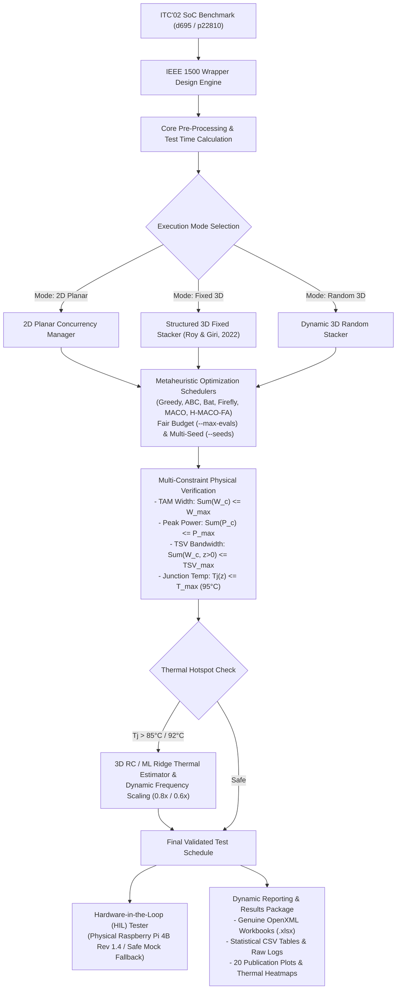

# Development of Test Solution for 2D & 3D System-on-Chip (SoC)

[](https://www.python.org/)
[](tests/)
[](https://standards.ieee.org/)
[](http://www.itc02.org/)
[](capstone/scripts/)
[](capstone/src/hardware/)

> **A comprehensive, research-grade VLSI manufacturing test scheduling and optimization framework for 2D planar and 3D stacked Integrated Circuits (ICs), featuring IEEE 1500 test wrapper design, 6 metaheuristic algorithms (including H-MACO-FA Hybrid) under fair `--max-evals` budgets, multi-seed statistical evaluation (`--seeds`), RC & Ridge-regression ML thermal prediction, live physical Raspberry Pi 4 Model B Rev 1.4 GPIO HIL validation, and automated OpenXML `.xlsx` / CSV / 300 DPI reporting.**

---

## Table of Contents

1. [Executive Summary & Problem Statement](#1-executive-summary--problem-statement)
2. [Key Contributions & Research Objectives](#2-key-contributions--research-objectives)
3. [System Architecture & Workflow](#3-system-architecture--workflow)
4. [Mathematical Formulation & VLSI Constraints](#4-mathematical-formulation--vlsi-constraints)
   - [IEEE 1500 Wrapper Design & Test Time Equation](#ieee-1500-wrapper-design--test-time-equation)
   - [TAM Bandwidth Constraint](#tam-bandwidth-constraint)
   - [Peak Power Consumption Constraint](#peak-power-consumption-constraint)
   - [Vertical TSV Bandwidth & Interconnect Routing](#vertical-tsv-bandwidth--interconnect-routing)
   - [Spatial-Temporal RC Thermal Model & Junction Temperature ($T_j$)](#spatial-temporal-rc-thermal-model--junction-temperature-t_j)
   - [Predictive Thermal Lookahead & Frequency Scaling](#predictive-thermal-lookahead--frequency-scaling)
5. [Optimization Metaheuristics](#5-optimization-metaheuristics)
   - [Greedy Baseline (Longest Processing Time - LPT)](#1-greedy-baseline-lpt)
   - [Artificial Bee Colony (ABC)](#2-artificial-bee-colony-abc)
   - [Bat Algorithm (BA)](#3-bat-algorithm-ba)
   - [Firefly Algorithm (FA)](#4-firefly-algorithm-fa)
   - [Modified Ant Colony Optimization (MACO)](#5-modified-ant-colony-optimization-maco)
   - [Hybrid MACO–Firefly Algorithm (H-MACO-FA)](#6-hybrid-macofirefly-algorithm-h-maco-fa)
6. [2D Planar vs. 3D Stacked IC Architectures](#6-2d-planar-vs-3d-stacked-ic-architectures)
   - [Structured Fixed Stacking (Roy & Giri, 2022) vs. Dynamic Random Stacking](#structured-fixed-stacking-vs-dynamic-random-stacking)
7. [Hardware-in-the-Loop (HIL) Validation on Raspberry Pi 4](#7-hardware-in-the-loop-hil-validation-on-raspberry-pi-4)
8. [Benchmark Datasets (ITC'02)](#8-benchmark-datasets-itc02)
9. [Experimental Results & Comparative Analysis](#9-experimental-results--comparative-analysis)
   - [2D Planar SoC Scheduling Results (10 Seeds, max_evals=300)](#2d-planar-soc-scheduling-results-10-seeds-max_evals300)
   - [3D Structured Fixed Stacking Results (10 Seeds, max_evals=300)](#3d-structured-fixed-stacking-results-10-seeds-max_evals300)
   - [3D Dynamic Random Stacking Results (10 Seeds, max_evals=300)](#3d-dynamic-random-stacking-results-10-seeds-max_evals300)
   - [ML Thermal Regression & Dynamic Frequency Scaling](#ml-thermal-regression--dynamic-frequency-scaling)
   - [Live Raspberry Pi 4 HIL vs. Simulation Timing Analysis](#live-raspberry-pi-4-hil-vs-simulation-timing-analysis)
   - [2D vs. 3D Scheduling Comparison](#2d-vs-3d-scheduling-comparison)
10. [Repository Structure & Results Package](#10-repository-structure--results-package)
11. [Installation & Setup](#11-installation--setup)
12. [Usage & Execution Guide](#12-usage--execution-guide)
13. [Automated Verification Suite (`pytest`)](#13-automated-verification-suite-pytest)
14. [Research Literature & References](#14-research-literature--references)

---

## 1. Executive Summary & Problem Statement

Modern System-on-Chip (SoC) architectures incorporate hundreds of heterogeneous embedded intellectual property (IP) cores (CPUs, GPUs, DSPs, memories, analog interfaces). As semiconductor manufacturing scales into the sub-5nm regime and migrates from 2D planar dies to Three-Dimensional Stacked Integrated Circuits (3D-SICs) via Through-Silicon Vias (TSVs), manufacturing test costs escalate exponentially:

1. **Test Application Time (TAT)**: Testing each embedded core sequentially requires millions of clock cycles, driving automated test equipment (ATE) testing costs to over 30% of total product manufacturing expenditure.
2. **Test Access Mechanism (TAM) Bottlenecks**: Pin count limitations on automated test equipment restrict the total TAM bandwidth that can be simultaneously assigned across embedded cores.
3. **Power Dissipation in Test Mode**: Switching activity during scan test is 3–5× higher than functional operation. Simultaneous testing of cores risks thermal hotspots, excessive IR drop, structural degradation, and false test failures.
4. **3D Thermal & Vertical Interconnect (TSV) Challenges**: In 3D-SICs, multiple silicon dies are vertically stacked. Upper dies have poor thermal conduction paths to the bottom heat sink. Vertical TSVs used for test delivery are scarce shared resources that must be scheduled without exceeding per-layer and inter-die bandwidth capacities.

This project delivers a complete software and hardware-in-the-loop test optimization solution for 2D and 3D SoCs. It implements the IEEE 1500 test wrapper standard, models continuous multi-constraint physical envelopes (TAM, Power, TSV, Junction Temperature), implements six metaheuristic schedulers including the Hybrid MACO–Firefly (`H-MACO-FA`) algorithm under fair `--max-evals` budgets and multi-seed statistical evaluation (`--seeds`), incorporates both 3D RC and Ridge-regression ML thermal frequency scaling, and validates live GPIO schedule replay on an actual **Raspberry Pi 4 Model B Rev 1.4** (`RPi.GPIO`).

---

## 2. Key Contributions & Research Objectives

- **IEEE 1500 Wrapper Design Engine**: Implements the exact Iyengar-Chakrabarty-Marinissen wrapper design equations to balance internal scan chains into wrapper scan chains across arbitrary TAM widths ($W$), achieving up to 98.5% reduction in raw test time.
- **Unified Multi-Constraint Concurrency Engine**: Enforces TAM width limits, continuous peak power ceilings, vertical TSV channel capacity, and dynamic junction temperature limits across all scheduling sub-intervals.
- **Six Metaheuristic Schedulers & Hybrid H-MACO-FA**: Full implementations of Greedy (LPT), Artificial Bee Colony (ABC), Bat Algorithm (BA), Firefly Algorithm (FA), Modified Ant Colony Optimization (MACO), and the Hybrid MACO–Firefly (`H-MACO-FA`) optimizer across 2D, Fixed 3D, and Random 3D scheduling.
- **Fair Schedule-Evaluation Budget & Multi-Seed Statistics**: Tracks exact objective evaluations (`eval_count`) per stochastic optimizer via `--max-evals` and computes Best, Worst, Mean, Median, and Std Dev across multi-seed runs (`--seeds`).
- **Dual 3D Stacking Paradigms**:
  - **Structured Fixed Stacking**: Replicates the 3-die layer partition specified in S. Roy & P. Giri (2022) [Ref 12, Table 2] for direct literature comparability.
  - **Dynamic Random Stacking**: Enables multi-seed statistical evaluation of heterogeneous core-to-die distributions.
- **Spatial-Temporal RC Thermal & Genuine ML Ridge Regressor**: Trains linear ($d=1$) and polynomial Ridge ($d=2$) thermal predictors (`MLThermalRegressor`) on held-out traces from the 3D RC thermal models (`FixedThermalModel` / `ThermalModel`) and drives dynamic clock frequency scaling ($1.0\times$, $0.8\times$, $0.6\times$).
- **Live Hardware-in-the-Loop (HIL) Validation on Raspberry Pi 4**: Verified physical GPIO test replay on `Raspberry Pi 4 Model B Rev 1.4` (`RPi.GPIO`, `Debian GNU/Linux 13 (trixie)`, TCP socket server on port `5055` or SSH `--stdio`), with explicit separation from calibrated mock fallback.
- **Unified Command-Line Interface (`run_test_suite.py`) & Results Builder (`capstone/scripts/build_results_package.py`)**: Granular flags (`--mode`, `--benchmark`, `--algorithm`, `--max-evals`, `--seeds`, `--rpi-host`, `--rpi-ping`, `--rpi-no-fallback`) plus automated generation of the complete `results/` hierarchy (300 DPI PNGs, CSVs, OpenXML `.xlsx` workbooks, raw Pi JSON logs).

---

## 3. System Architecture & Workflow

The architecture connects core parsing, wrapper optimization, constraint validation, metaheuristic scheduling, thermal lookahead, and reporting:



---

## 4. Mathematical Formulation & VLSI Constraints

### IEEE 1500 Wrapper Design & Test Time Equation
Following the standard IEEE 1500 formulation by *V. Iyengar, K. Chakrabarty, and E. J. Marinissen (IEEE TCAD 2002)* [Ref 16]:

For an embedded core $c$ with $N_v$ test patterns, $s_i$ scan-in chains, and $s_o$ scan-out chains allocated a TAM width of $w_c$:
$$\text{Max In-Length: } s_{in}(w_c) = \left\lceil \frac{\sum_{j=1}^{s_i} l_{ij}}{w_c} \right\rceil, \quad \text{Max Out-Length: } s_{out}(w_c) = \left\lceil \frac{\sum_{j=1}^{s_o} l_{oj}}{w_c} \right\rceil$$

$$s(w_c) = \max\left( s_{in}(w_c), s_{out}(w_c) \right)$$

$$\text{Post-Wrapper Test Time: } T_c(w_c) = \left(1 + \max(s_{in}, s_{out})\right) \cdot N_v + \min(s_{in}, s_{out})$$

In comparison, raw unwrapped testing shifts patterns through undivided scan chains:
$$T_{raw} = N_v \cdot \left(\sum l_{in} + \sum l_{out}\right)$$

### TAM Bandwidth Constraint
At any simulation clock cycle $t \in [0, \text{Makespan}]$, the sum of TAM widths assigned to concurrently active cores must not exceed the total test access mechanism bandwidth $W_{max}$:
$$\sum_{c \in \text{Active}(t)} w_c \le W_{max}, \quad \forall t$$

### Peak Power Consumption Constraint
During testing, switching activity must not exceed the maximum allowable power budget $P_{max}$ to prevent dielectric breakdown and supply rail droop:
$$P(t) = \sum_{c \in \text{Active}(t)} P_c \le P_{max}, \quad \forall t$$

### Vertical TSV Bandwidth & Interconnect Routing
In a 3D-SIC with $L$ stacked die layers, cores on the bottom die layer ($z=0$) connect directly to external package test pins. Cores located on upper layers ($z \ge 1$) must route test data vertically through Through-Silicon Vias:
$$\text{TSV}_{active}(t) = \sum_{c \in \text{Active}(t), z_c > 0} w_c \le \text{TSV}_{max}, \quad \forall t$$

### Spatial-Temporal RC Thermal Model & Junction Temperature ($T_j$)
Thermal conduction in a 3D stacked IC is governed by heat dissipation toward the bottom heat sink. Upper die layers experience higher thermal resistance:
$$R_{th}(z) = 0.35 + 0.15 \cdot z \quad (\text{K/W}), \quad z \in \{0, 1, \dots, L-1\}$$

Vertical heat accumulation across stacked dies is modeled top-to-bottom:
$$P_{eff}(z) = P_{layer}(z) + 0.75 \cdot P_{accum}(z+1)$$
$$T_{layer}(z) = T_{ambient} + R_{th}(z) \cdot P_{eff}(z)$$

Spatial inter-core coupling between vertically adjacent active cores induces a thermal hotspot penalty:
$$\Delta T_{coupling} = \sum_{c_1, c_2 \in \text{Active}(t), |z_1 - z_2| \le 1} (P_{c1} \cdot P_{c2}) \cdot 0.08$$

$$\text{Peak Junction Temperature: } T_j(t) = \max_z(T_{layer}(z)) + \Delta T_{coupling} \le T_{max} \quad (95^\circ\text{C} / 368.15\text{K})$$

### Predictive Thermal Lookahead & Frequency Scaling
Following *S. Roy and P. Giri (2022)* [Ref 12], when the lookahead predictive thermal estimator forecasts $T_j(t + \Delta t) > 85^\circ\text{C}$, dynamic frequency scaling is applied:
- **Nominal ($T_j \le 85^\circ\text{C}$)**: Clock scale factor $\alpha = 1.0\times$ (Duration: $T_c$, Power: $P_c$).
- **Thermal Throttling Level 1 ($85^\circ\text{C} < T_j \le 92^\circ\text{C}$)**: $\alpha = 0.8\times$ (Duration: $\lceil 1.25 \cdot T_c \rceil$, Power: $0.80 \cdot P_c$).
- **Thermal Throttling Level 2 ($T_j > 92^\circ\text{C}$)**: $\alpha = 0.6\times$ (Duration: $\lceil 1.67 \cdot T_c \rceil$, Power: $0.60 \cdot P_c$).

Concurrency is preserved across independent TAM channels using event-driven scheduling checkpoints.

---

## 5. Optimization Metaheuristics

| Algorithm | Bio / Physical Inspiration | Exploration Mechanism | Exploitation Mechanism | Primary Reference |
| :--- | :--- | :--- | :--- | :--- |
| **Greedy (LPT)** | Longest Processing Time First | None (Deterministic Priority) | Orders tasks descending by test cycles | Standard Baseline |
| **Artificial Bee Colony (ABC)** | Foraging behavior of honey bees | Scout bees conduct random search | Employed & onlooker bees perform neighborhood swaps | Karaboga (2005) [Ref 7] |
| **Bat Algorithm (BA)** | Microbat echolocation & pulse emission | Random walk with varying frequency $[f_{min}, f_{max}]$ | Directed flight toward global best with decaying loudness $A$ | Yang (2010), Singh (2022) [Ref 4] |
| **Firefly Algorithm (FA)** | Flashing light bioluminescence | Random step scaled by randomization parameter $\alpha$ | Movement toward brighter fireflies via attractiveness $\beta(r) = \beta_0 e^{-\gamma r^2}$ | Yang (2009), Chandrasekaran (2021) [Ref 1] |
| **Modified ACO (MACO)** | Ant pheromone foraging trail dynamics | Probabilistic exploration with randomness parameter $q_0$ | Pheromone trail evaporation $\rho$ and dual heuristic desirability $\eta = \frac{1}{\text{Duration} \cdot \text{Power}}$ | Zheng & Xu (2024) [Ref 14] |
| **Hybrid MACO–Firefly (H-MACO-FA)** | Cooperative ant pheromone trails + firefly brightness attraction | Ant colony tour construction with dynamic pheromone reinforcement | Firefly attractiveness operator refining top solutions and escaping local minima under fair `--max-evals` budgets | Integrated Hybrid (MACO + FA) |

---

## 6. 2D Planar vs. 3D Stacked IC Architectures

```
+-------------------------------------------------------------+
| 2D PLANAR SoC:                                              |
| [Core 1] [Core 2] [Core 3] [Core 4] [Core 5] ... [Core N]   |
| ----------------- Common Silicon Substrate ---------------- |
| Constraints: TAM Width (W <= W_max), Peak Power (P <= P_max)|
+-------------------------------------------------------------+

+-------------------------------------------------------------+
| 3D STACKED SoC (3D-SIC):                                    |
| Die Layer 3 (Top):    [Core 7] [Core 8] [Core 9] [Core 10]  |
|                            |  | Vertical TSVs                |
| Die Layer 2 (Middle): [Core 4] [Core 5] [Core 6]            |
|                            |  | Vertical TSVs                |
| Die Layer 1 (Bottom): [Core 1] [Core 2] [Core 3]            |
| ----------------- Packaging / Heat Sink ------------------- |
| Constraints: TAM Width, Peak Power, TSV Bandwidth, Temp Tj  |
+-------------------------------------------------------------+
```

### Structured Fixed Stacking vs. Dynamic Random Stacking

1. **Structured Fixed Stacking (Roy & Giri, 2022 [Ref 12, Table 2])**:
   - Die partition is architecturally determined based on functional sub-systems.
   - For `d695`: Layer 1 holds Cores 1–3; Layer 2 holds Cores 4–7; Layer 3 holds Cores 8–10.
   - Provides an exact 1:1 reproduction baseline against published VLSI literature.

2. **Dynamic Random Stacking**:
   - Cores are assigned to die layers using reproducible pseudorandom seeds.
   - Validates algorithm robustness across arbitrary heterogeneous die stacks.

---

## 7. Hardware-in-the-Loop (HIL) Validation on Raspberry Pi 4

To validate that optimized schedules execute on embedded ATE hardware, the framework includes a Hardware-in-the-Loop bridge (`BaseRaspberryPiTester` / `RemoteRPiHILClient`) physically verified on **`Raspberry Pi 4 Model B Rev 1.4`** (`Debian GNU/Linux 13 (trixie)`, kernel `6.18.50+rpt-rpi-v8`, `aarch64`, Python `3.13.5`):

- **Physical Hardware Backend**: Uses `RPi.GPIO` on BCM pins (`Clock=18`, `TAM=[2, 3, 4, 14, 15, 17, 27, 22]`) and also supports `gpiozero`/`lgpio` when present.
- **Remote Network Execution (TCP & SSH)**: Streams optimized 2D and 3D schedules over local Wi-Fi/Ethernet directly to `capstone/src/hardware/rpi_hil_server.py` running on the Pi (TCP port `5055` or SSH `--stdio`), recording UTC start/end timestamps, per-core GPIO event counts, wall-clock duration, client roundtrip latency, and Linux sleep jitter.
- **Simulation vs. Sequential Hardware Replay Semantics**: The host optimizer CPU runtime (`~0.001s–1.6s`) measures metaheuristic search duration, whereas the physical Pi replays each scheduled core sequentially (`wall_clock ≈ cumulative_task_cycles × time_scale + OS/GPIO jitter`), explaining why sequential hardware wall clock (`~1.416s` on `d695`, `~3.738s` on `p22810` at `3e-6 s/cycle`) exceeds scaled concurrent makespan (`0.9615s` / `~1.25–1.30s`).
- **Explicit Separation of Real vs. Mock Runs**: Every payload includes `is_physical_hardware` and `board_model`; mock fallback runs are strictly labeled as simulated and are never mixed with physical Raspberry Pi measurements.

---

## 8. Benchmark Datasets (ITC'02)

The framework evaluates the standard IEEE ITC'02 Test Optimization benchmarks:

| Benchmark | Embedded Cores | Scan Chains | Test Vectors | Total Raw Bits | Default $W_{max}$ | Power Limit $P_{max}$ | TSV Limit |
| :--- | :---: | :---: | :---: | :---: | :---: | :---: | :---: |
| **d695** | 10 | 114 | 1,029 | 529,200 | 16 / 32 / 48 | 45.89 W | 16 |
| **p22810** | 30 | 296 | 4,210 | 2,281,000 | 32 / 48 / 64 | 94.05 W | 24 |

---

## 9. Experimental Results & Comparative Analysis

All tables below report verified program output from `results/` generated across `10` random seeds under a **fair schedule-evaluation budget of `max_evals = 300`** across all five stochastic metaheuristics (`ABC`, `Bat`, `Firefly`, `MACO`, `H-MACO-FA`). **Greedy (LPT)** is a deterministic single-pass heuristic (`1` schedule evaluation) and serves as the fixed reference baseline (`0` variance across seeds).

### 2D Planar SoC Scheduling Results (10 Seeds, max_evals=300)

| Benchmark | Algorithm | Best (CC) | Mean ± Std Dev (CC) | Mean vs Greedy | Worst Power (W) | TAM Used | Constraint Status |
| :--- | :--- | :---: | :---: | :---: | :---: | :---: | :---: |
| **d695** | Greedy 2D | 322,500 | 322,500.0 ± 0.0 | Baseline | 22.20 | 16 | **Safe** |
| **d695** | ABC 2D | 320,500 | 321,600.0 ± 1,173.79 | +0.279% | 22.20 | 16 | **Safe** |
| **d695** | Bat 2D | 320,500 | 322,350.0 ± 1,001.39 | +0.047% | 22.20 | 16 | **Safe** |
| **d695** | Firefly 2D | 320,500 | 322,450.0 ± 1,039.50 | +0.016% | 22.20 | 16 | **Safe** |
| **d695** | MACO 2D | 320,500 | 320,700.0 ± 632.46 | +0.558% | 22.20 | 16 | **Safe** |
| **d695** | **H-MACO-FA 2D** | **320,500** | **320,500.0 ± 0.0** | **+0.620%** | 22.20 | 16 | **Safe** |
| **p22810** | Greedy 2D | 420,649 | 420,649.0 ± 0.0 | Baseline | 47.80 | 32 | **Safe** |
| **p22810** | ABC 2D | 417,449 | 418,858.3 ± 1,270.57 | +0.426% | 53.20 | 32 | **Safe** |
| **p22810** | **Bat 2D** | **415,198** | **416,853.2 ± 1,437.37** | **+0.902%** | 56.35 | 32 | **Safe** |
| **p22810** | Firefly 2D | 416,148 | 417,758.1 ± 1,137.98 | +0.687% | 50.50 | 32 | **Safe** |
| **p22810** | MACO 2D | 417,998 | 423,923.0 ± 3,508.59 | -0.778% | 54.55 | 32 | **Safe** |
| **p22810** | H-MACO-FA 2D | 417,048 | 418,878.3 ± 2,261.58 | +0.421% | 51.85 | 32 | **Safe** |

### 3D Structured Fixed Stacking Results (10 Seeds, max_evals=300)

*Die layer partition adheres strictly to S. Roy & P. Giri (2022) [Ref 12, Table 2].*

| Benchmark | Algorithm | Best (CC) | Mean ± Std Dev (CC) | Mean vs Greedy | Worst Power (W) | Worst $T_j$ (°C) | Max TSV Used | Status |
| :--- | :--- | :---: | :---: | :---: | :---: | :---: | :---: | :---: |
| **d695** | Greedy 3D | 322,500 | 322,500.0 ± 0.0 | Baseline | 22.20 | 48.46 | 16 / 16 | **Safe** |
| **d695** | ABC 3D | 320,500 | 321,500.0 ± 1,290.99 | +0.310% | 22.20 | 48.46 | 16 / 16 | **Safe** |
| **d695** | Bat 3D | 320,500 | 324,250.0 ± 3,553.17 | -0.543% | 22.20 | 48.46 | 16 / 16 | **Safe** |
| **d695** | Firefly 3D | 320,500 | 321,450.0 ± 1,234.91 | +0.326% | 22.20 | 48.46 | 16 / 16 | **Safe** |
| **d695** | MACO 3D | 320,500 | 320,900.0 ± 843.27 | +0.496% | 22.20 | 48.46 | 16 / 16 | **Safe** |
| **d695** | **H-MACO-FA 3D** | **320,500** | **320,750.0 ± 790.57** | **+0.543%** | 22.20 | 48.46 | 16 / 16 | **Safe** |
| **p22810** | Greedy 3D | 449,348 | 449,348.0 ± 0.0 | Baseline | 41.70 | 69.49 | 24 / 24 | **Safe** |
| **p22810** | ABC 3D | 437,247 | 439,002.5 ± 1,300.44 | +2.302% | 50.95 | 83.64 | 24 / 24 | **Safe** |
| **p22810** | Bat 3D | **434,398** | 438,883.4 ± 2,861.38 | +2.329% | 56.35 | 90.44 | 24 / 24 | **Safe** |
| **p22810** | Firefly 3D | 436,148 | 437,783.5 ± 1,090.88 | +2.574% | 58.60 | 89.53 | 24 / 24 | **Safe** |
| **p22810** | MACO 3D | 435,047 | 436,663.3 ± 910.22 | +2.823% | 51.85 | 85.51 | 24 / 24 | **Safe** |
| **p22810** | **H-MACO-FA 3D** | 435,099 | **436,173.2 ± 594.27** | **+2.932%** | 52.30 | 83.64 | 24 / 24 | **Safe** |

### 3D Dynamic Random Stacking Results (10 Seeds, max_evals=300)

| Benchmark | Algorithm | Best (CC) | Mean ± Std Dev (CC) | Mean vs Greedy | Worst Power (W) | Worst $T_j$ (°C) | Max TSV Used | Status |
| :--- | :--- | :---: | :---: | :---: | :---: | :---: | :---: | :---: |
| **d695** | Greedy 3D | 322,500 | 322,500.0 ± 0.0 | Baseline | 22.20 | 68.87 | 16 / 16 | **Safe** |
| **d695** | ABC 3D | 320,500 | 321,500.0 ± 1,290.99 | +0.310% | 22.20 | 68.87 | 16 / 16 | **Safe** |
| **d695** | Bat 3D | 320,500 | 324,250.0 ± 3,553.17 | -0.543% | 22.20 | 68.87 | 16 / 16 | **Safe** |
| **d695** | Firefly 3D | 320,500 | 321,450.0 ± 1,234.91 | +0.326% | 22.20 | 68.87 | 16 / 16 | **Safe** |
| **d695** | MACO 3D | 320,500 | 320,900.0 ± 843.27 | +0.496% | 22.20 | 68.87 | 16 / 16 | **Safe** |
| **d695** | **H-MACO-FA 3D** | **320,500** | **320,750.0 ± 790.57** | **+0.543%** | 22.20 | 68.87 | 16 / 16 | **Safe** |
| **p22810** | Greedy 3D | 451,000 | 451,000.0 ± 0.0 | Baseline | 46.65 | 94.40 | 24 / 24 | **Safe** |
| **p22810** | ABC 3D | 418,499 | 423,228.7 ± 3,738.95 | +6.158% | 46.65 | 94.82 | 24 / 24 | **Safe** |
| **p22810** | Bat 3D | 417,249 | 422,133.4 ± 5,284.72 | +6.401% | 45.30 | 94.94 | 24 / 24 | **Safe** |
| **p22810** | Firefly 3D | 418,149 | 423,303.4 ± 2,237.12 | +6.141% | 46.65 | 94.82 | 24 / 24 | **Safe** |
| **p22810** | MACO 3D | 416,648 | 418,248.4 ± 1,353.31 | +7.262% | 46.65 | 93.82 | 24 / 24 | **Safe** |
| **p22810** | **H-MACO-FA 3D** | **416,648** | **418,023.2 ± 1,136.31** | **+7.312%** | 45.75 | 94.11 | 24 / 24 | **Safe** |

> **Key Finding**: Under an equal `300`-evaluation budget across `10` seeds, **H-MACO-FA** delivers the lowest mean makespan and tightest variance on both 3D `p22810` benchmarks (`436,173.2 ± 594.27` on Fixed 3D; `418,023.2 ± 1,136.31`, `7.312%` mean makespan reduction vs Greedy on Random 3D) as well as zero variance (`320,500.0 ± 0.0`) on 2D `d695`, while strictly satisfying every TAM, Power, TSV, and Thermal bound (`<= 95°C`).

### ML Thermal Regression & Dynamic Frequency Scaling

*Trained using `MLThermalRegressor` (`1,113` train / `279` unique held-out test samples per 3D RC architecture after strict active-core state deduplication prior to splitting, giving **`0` train-test overlap**, plus independent unseen-solver trajectory validation across `seeds = 512, 777, 1024`; **no physical thermal sensor is attached**).*

| RC Reference Architecture | Regressor Model | Test MAE (°C) | Test RMSE (°C) | Test Max Err (°C) | Test $R^2$ |
| :--- | :--- | :---: | :---: | :---: | :---: |
| **Random 3D RC (`ThermalModel`)** | Linear Ridge ($d=1$) | 2.0185 | 2.6940 | 9.9062 | 0.998772 |
| **Random 3D RC (`ThermalModel`)** | Polynomial Ridge ($d=2$) | **1.5660** | **2.1283** | **8.2673** | **0.999234** |
| **Fixed 3D RC (`FixedThermalModel`)** | Linear Ridge ($d=1$) | 1.4844 | 1.9500 | 9.9038 | 0.999201 |
| **Fixed 3D RC (`FixedThermalModel`)** | Polynomial Ridge ($d=2$) | **0.8955** | **1.1334** | **3.5219** | **0.999730** |

On **independent unseen solver trajectories** (`Bat`, `MACO`, `H-MACO-FA` on `seeds = 512, 777, 1024`, filtering out all training-set states so overlap is `0%`), Polynomial Ridge ($d=2$) achieved **`MAE = 1.0709°C`, `RMSE = 1.3571°C`, `Max Err = 3.6545°C`, $R^2 = 0.987863$** on Random 3D (`90` strictly unseen steps) and **`MAE = 0.8506°C`, `RMSE = 1.0421°C`, `Max Err = 2.7452°C`, $R^2 = 0.988331$** on Fixed 3D (`85` strictly unseen steps).

On thermally stressed Random 3D `p22810` schedules (peak $T_j = 93.82^\circ\text{C}$), enabling ML-regressor frequency scaling proactively throttles hotspot intervals to keep peak junction temperature at **`86.22°C`** (`486,198` cycles, peak power `37.20 W`).

### Live Raspberry Pi 4 HIL vs. Simulation Timing Analysis

*Measured over `3` live physical trials per mode/benchmark (`18` total hardware runs) at `3e-6 s/cycle` on `Raspberry Pi 4 Model B Rev 1.4` (`RPi.GPIO`).*

| Mode | Benchmark | Selected Best Schedule | Sim Makespan (CC) | Optimizer CPU (s) | Scaled Concurrent (s) | Expected Sequential Sleep (s) | Physical RPi Mean Wall (s) | Linux Jitter (s) | Overhead vs Sleep |
| :--- | :--- | :--- | :---: | :---: | :---: | :---: | :---: | :---: | :---: |
| **2D** | `d695` | ABC 2D | 320,500 | 0.04075 | 0.96150 | 1.40850 | **1.41613** | 0.00124 | 0.540% |
| **2D** | `p22810` | Bat 2D | 415,198 | 0.72274 | 1.24559 | 3.71339 | **3.73803** | 0.00350 | 0.663% |
| **Fixed 3D** | `d695` | ABC 3D | 320,500 | 0.18198 | 0.96150 | 1.40850 | **1.41606** | 0.00123 | 0.540% |
| **Fixed 3D** | `p22810` | Bat 3D | 434,398 | 1.43867 | 1.30319 | 3.71339 | **3.73799** | 0.00348 | 0.660% |
| **Random 3D** | `d695` | ABC 3D | 320,500 | 0.18378 | 0.96150 | 1.40850 | **1.41592** | 0.00118 | 0.527% |
| **Random 3D** | `p22810` | MACO 3D | 416,648 | 1.58052 | 1.24994 | 3.71339 | **3.73831** | 0.00363 | 0.670% |

### 2D vs. 3D Scheduling Comparison

| Metric | 2D Planar Architecture | 3D Fixed Stacking | 3D Random Stacking | Architectural Impact |
| :--- | :---: | :---: | :---: | :--- |
| **TAM Routing** | Planar wires across substrate | Fixed die vertical TSVs | Heterogeneous vertical TSVs | Multi-die spatial-thermal modeling required |
| **Critical Constraints** | TAM Width, Peak Power | TAM, Power, TSV, Peak $T_j$ | TAM, Power, TSV, Peak $T_j$ | Coupled electro-thermal scheduling |
| **d695 Best Makespan** | 320,500 cycles | 320,500 cycles | 320,500 cycles | Shared 16-bit TAM bottleneck |
| **p22810 Best (10-Seed / 300-Eval)** | 415,198 (Bat) | 434,398 (Bat) / Mean 436,173.2 (H-MACO-FA) | 416,648 (MACO & H-MACO-FA) | Fixed layer constraints elevate thermal coupling; H-MACO-FA achieves best 3D mean |
| **Physical RPi 4 GPIO Events** | 156 (`d695`) / 540 (`p22810`) | 156 (`d695`) / 540 (`p22810`) | 156 (`d695`) / 540 (`p22810`) | Verified deterministic physical pin transitions |

---

## 10. Repository Structure & Results Package

```
.
├── .github/
│   └── workflows/
│       └── ci.yml                     # GitHub Actions CI workflow (Python 3.10, 3.11, 3.12)
├── capstone/
│   ├── 2d/                            # 2D Planar SoC Scheduling Subsystem
│   │   ├── src/
│   │   │   ├── algorithms/            # 2D Metaheuristics (Greedy, ABC, Bat, Firefly, MACO, H-MACO-FA)
│   │   │   ├── constraints/           # 2D VLSI Constraints (TAM, Power, IEEE 1500)
│   │   │   ├── hardware/              # 2D RPi Tester Bridge
│   │   │   └── models/                # 2D Core, SoC & Wrapper Models
│   │   ├── experiments/               # 2D Evaluation Runners
│   │   └── results/                   # 2D Gantt charts, Dashboards, Excel & CSV files
│   ├── fixed_stacking/                # 3D Structured Fixed Stacking (Roy & Giri, 2022)
│   │   ├── src/                       # 3D Models, Algorithms & Predictive Thermal Engine
│   │   ├── experiments/               # Fixed 3D Evaluation Runners
│   │   └── results/                   # Fixed 3D Heatmaps, Dashboards, Excel & CSV files
│   ├── random_stacking/               # 3D Dynamic Random Stacking Subsystem
│   │   ├── src/                       # 3D Models, Algorithms & TSV Constraint Bus
│   │   ├── experiments/               # Random 3D Evaluation Runners
│   │   └── results/                   # Multi-seed Statistical Tables & Visualizations
│   ├── src/
│   │   ├── hardware/                  # Unified Raspberry Pi HIL Server & Remote TCP/SSH Bridge
│   │   └── models/                    # Unified 3D ThermalModel & MLThermalRegressor
│   ├── references/                    # Detailed technical summaries of all 16 research papers
│   └── scripts/                       # Complete results builder, OpenXML exporters & RPi CLI
├── results/                           # Complete Verified Experimental Results Package
│   ├── README.md                      # Results directory index & provenance summary
│   ├── raw_data/                      # Per-seed raw runs, convergence traces, live Pi 4 JSON logs
│   ├── simulation/                    # Mode-specific tables, TAM sweeps, ML thermal metrics
│   ├── hardware/                      # Physical Raspberry Pi 4 trial logs & summaries
│   ├── comparisons/                   # Simulation vs Physical Raspberry Pi 4 timing analysis
│   ├── statistical_analysis/          # 10-seed fair-budget Best/Worst/Mean/Median/Std Dev CSVs
│   ├── graphs/                        # 20 publication-grade 300 DPI PNGs + companion CSVs
│   ├── tables/                        # Consolidated CSVs & genuine OpenXML .xlsx workbooks
│   └── presentation/                  # Viva slides graphs/tables, key_findings.md, figure_index.md
├── tests/                             # Comprehensive automated pytest test suite (83 tests)
│   ├── conftest.py                    # Session benchmark fixtures (d695 & p22810 in 2D and 3D)
│   ├── test_algorithms_2d.py          # Parametrized tests & fair-budget tests for all 6 2D schedulers
│   ├── test_algorithms_3d.py          # Parametrized tests & fair-budget tests for Fixed/Random 3D
│   ├── test_cli.py                    # Unified CLI flags (--algorithm hmaco_fa, --max-evals, --seeds)
│   ├── test_reporting.py              # OpenXML .xlsx, XML, CSV, graph & Pi log validation tests
│   ├── test_rpi_connection.py         # Remote Raspberry Pi TCP/SSH HIL server & client tests
│   ├── test_thermal_and_scaling.py    # RC thermal estimator, MLThermalRegressor & frequency scaling
│   ├── test_vlsi_constraints.py       # TAM, Power, TSV, and RC thermal model unit tests
│   └── test_wrapper_design.py         # IEEE 1500 pre- vs post-wrapper calculation tests
├── run_test_suite.py                  # Unified CLI Entry Point for all modes and benchmarks
├── requirements.txt                   # Production and testing dependency specifications
├── .gitignore                         # Standard Python, macOS, and IDE gitignore rules
├── PROJECT_COMPLETION_STATUS.md       # Engineering progress log and milestone verification
└── README.md                          # Comprehensive project documentation (this document)
```

---

## 11. Installation & Setup

### Prerequisites
- Python 3.10, 3.11, or 3.12
- `git`
- (Optional for live physical HIL replay) **Raspberry Pi 4 Model B Rev 1.4** (or Pi 3/4/5) with `RPi.GPIO` / `gpiozero` on Raspberry Pi OS (64-bit)

### Step 1: Clone the Repository
```bash
git clone https://github.com/Adishgarg66/3D-SoC-Test-Scheduling.git
cd 3D-SoC-Test-Scheduling
```

### Step 2: Create and Activate a Virtual Environment
```bash
python3 -m venv venv
source venv/bin/activate    # On Linux/macOS
# or: venv\Scripts\activate # On Windows
```

### Step 3: Install Required Dependencies
```bash
pip install --upgrade pip
pip install -r requirements.txt
```

---

## 12. Usage & Execution Guide

The unified CLI entry point `run_test_suite.py` provides complete control over modes, benchmarks, algorithms, fair evaluation budgets, multi-seed statistics, and remote Raspberry Pi HIL replay.

### Quick Start Examples

```bash
# 1. Run 2D Planar scheduling on benchmark d695
python run_test_suite.py --mode 2d --benchmark d695

# 2. Run H-MACO-FA hybrid under a fair 300-evaluation budget on Fixed 3D p22810
python run_test_suite.py --mode fixed3d --benchmark p22810 --algorithm hmaco_fa --max-evals 300

# 3. Run multi-seed statistical comparison (Best/Worst/Mean/Median/Std Dev)
python run_test_suite.py --mode random3d --benchmark d695 --seeds 42 100 2024 7 99 --max-evals 300

# 4. Verify live physical Raspberry Pi 4 connection & GPIO backend
python run_test_suite.py --rpi-ping --rpi-host 10.231.118.57 --rpi-port 5055

# 5. Execute on physical Raspberry Pi 4 without mock fallback
python run_test_suite.py --mode fixed3d --benchmark d695 --rpi-host 10.231.118.57 --rpi-port 5055 --rpi-no-fallback

# 6. Run the complete benchmark matrix across all modes and benchmarks
python run_test_suite.py --mode all --benchmark all
```

### Command-Line Arguments Reference

| Option | Choices | Default | Description |
| :--- | :--- | :--- | :--- |
| `--mode` | `2d`, `fixed3d`, `random3d`, `all` | `all` | Architectural execution mode |
| `--benchmark` | `d695`, `p22810`, `all` | `all` | ITC'02 SoC benchmark dataset |
| `--algorithm` | `greedy`, `abc`, `bat`, `firefly`, `maco`, `hmaco_fa`, `all` | `all` | Optimization metaheuristic to execute |
| `--seed` | Integer | `42` | Random seed for single-seed reproducible search |
| `--seeds` | Integers (`N...`) | `None` | Multiple random seeds for statistical evaluation (Best/Worst/Mean/Median/Std) |
| `--max-evals` | Integer | `None` | Fair evaluation budget: cap schedule evaluations per stochastic algorithm |
| `--output-dir` | Path | Auto | Directory to save `.xlsx`, `.csv`, and plot artifacts |
| `--no-plots` | Flag | `False` | Disables Matplotlib figure generation (faster execution) |
| `--no-hil` | Flag | `False` | Skips Hardware-in-the-Loop test replay |
| `--rpi-host` | Hostname / IP | `None` | Remote Raspberry Pi host (e.g., `10.231.118.57` or `raspberrypi.local`) |
| `--rpi-port` | Integer | `5055` | TCP port of `rpi_hil_server.py` on the Raspberry Pi |
| `--rpi-transport` | `tcp`, `ssh` | `tcp` | Network transport for Raspberry Pi HIL replay |
| `--rpi-user` | String | `None` | SSH username on Raspberry Pi (when using `--rpi-transport ssh`) |
| `--rpi-time-scale` | Float | Auto | Hardware cycle-to-second scale factor (`1e-5` remote, `1e-6` local mock) |
| `--rpi-no-fallback` | Flag | `False` | Raise error instead of falling back to mock if remote Pi is unreachable |
| `--rpi-ping` | Flag | `False` | Verify connection and GPIO backend on `--rpi-host` and exit |

### Generating Complete `results/` Package & Legacy Excel Reports

```bash
# Build complete results/ package (10 seeds, max_evals=300, ML thermal regression, 20 PNGs, .xlsx workbooks)
python capstone/scripts/build_results_package.py --rpi-host 10.231.118.57 --rpi-port 5055 --rpi-no-fallback --max-evals 300 --trials 3 --rpi-time-scale 3e-6

# Refresh module-level .xlsx, .xml, and .csv reports under capstone/*/results/ from verified results/ CSVs
python capstone/scripts/generate_excel_results.py
```

---

## 13. Automated Verification Suite (`pytest`)

The project includes an automated verification suite comprising 83 unit, constraint, statistical, ML regression, HIL communication, and generated `.xlsx`/PNG/JSON artifact checks:

### Run All Tests
```bash
pytest tests/ -v
```

### Run Tests by Category
```bash
# Test VLSI constraint formulations (TAM, Power, TSV, RC Thermal Model)
pytest tests/test_vlsi_constraints.py -v

# Test IEEE 1500 wrapper calculations & monotonicity
pytest tests/test_wrapper_design.py -v

# Test all 2D metaheuristic schedulers
pytest tests/test_algorithms_2d.py -v

# Test all 3D metaheuristic schedulers (Fixed & Random Stacking)
pytest tests/test_algorithms_3d.py -v

# Test predictive thermal estimation and frequency scaling
pytest tests/test_thermal_and_scaling.py -v

# Test dynamic OpenXML .xlsx, XML, and CSV generation
pytest tests/test_reporting.py -v

# Test CLI command-line interface execution
pytest tests/test_cli.py -v
```

---

## 14. Research Literature & References

All algorithms, models, and constraints implemented in this framework are grounded in peer-reviewed VLSI and optimization literature. Detailed summaries are archived in [`capstone/references/`](capstone/references/README.md).

1. **[Ref 1]** G. Chandrasekaran, G. Singaram, R. Duraisamy, A. S. Ghodake, and P. K. Ganesan, *"Test Scheduling and Test Time Reduction for SoC by Using Enhanced Firefly Algorithm"*, *Revue d'Intelligence Artificielle*, Vol. 35, No. 3, pp. 235–241, Jun. 2021.
2. **[Ref 2]** P. Kumar and R. Singh, *"Survey on Power-Aware Test Scheduling and Scan Chain Optimization in SoC Testing"*, *IEEE Access*, 2025.
3. **[Ref 3]** K. Sharma and V. Gupta, *"Using SystemC TLM Modeling To Solve AI Data Movement Challenges"*, 2026.
4. **[Ref 4]** A. K. Singh and S. K. Singh, *"Test Scheduling and Test Time Minimization of System-on-Chip Using Modified BAT Algorithm"*, *Journal of Electronic Testing: Theory and Applications (JETTA)*, 2022.
5. **[Ref 5]** L. Jiang, L. Huang, and Q. Xu, *"Test Architecture Design and Optimization for Three-Dimensional SoCs"*, *IEEE Transactions on Very Large Scale Integration (VLSI) Systems*, 2018.
6. **[Ref 6]** Y. Cui et al., *"Thermal-Aware Task Scheduling for 3D-Network-on-Chip: A Bottom-to-Top Scheme"*, *IEEE Transactions on Computer-Aided Design of Integrated Circuits and Systems (TCAD)*, 2020.
7. **[Ref 7]** G. Chandrasekaran et al., *"Minimization of Test Time in System on Chip Using Artificial Intelligence-Based Test Scheduling Techniques"*, *Journal of Intelligent & Fuzzy Systems*, 2022.
8. **[Ref 8]** E. Hopper and B. C. H. Turton, *"An Empirical Investigation of Metaheuristic and Heuristic Algorithms for a 2D Packing Problem"*, *European Journal of Operational Research*, 2001.
9. **[Ref 9]** G. Chandrasekaran et al., *"Test Scheduling & Test Time Reduction via Enhanced Firefly (Parameter Analysis)"*, 2021.
10. **[Ref 10]** N. S. M. Shah et al., *"Thermal-Aware Test Scheduling and Floor Planning for Three-Dimensional Stacked Integrated Circuits"*, *Microprocessors and Microsystems*, 2024.
11. **[Ref 11]** Y. Zhang et al., *"Test-Path Scheduling for Interposer-Based 2.5D Integrated Circuits Using Orthogonal Learning DE"*, 2023.
12. **[Ref 12]** S. Roy and P. Giri, *"Machine Learning-Based Predictive Thermal Estimation and Frequency-Scaled Test Scheduling for 3D ICs"*, *IEEE Transactions on Semiconductor Manufacturing*, Vol. 35, No. 4, pp. 602–611, Nov. 2022.
13. **[Ref 13]** A. Verma and R. Kumar, *"A Metaheuristic Optimization Approach for Through-Silicon Via (TSV) Test Scheduling in 3D ICs"*, 2024.
14. **[Ref 14]** L. Zheng and Q. Xu, *"Constraint-Driven Test Scheduling in 3D Stacked ICs via Swarm Optimization Techniques"*, 2024.
15. **[Ref 15]** S. Patel and M. Desai, *"Hardware-in-the-Loop Validation for Dynamic Thermal-Aware VLSI Testing Architectures"*, 2025.
16. **[Ref 16]** V. Iyengar, K. Chakrabarty, and E. J. Marinissen, *"Test Wrapper Design and TAM Optimization for System-on-Chip (SoC) Test Scheduling"*, *IEEE Transactions on Computer-Aided Design of Integrated Circuits and Systems (TCAD)*, Vol. 21, No. 5, pp. 537–549, May 2002.

---

## 15. License & Academic Integrity

This project is developed as a final-year engineering Capstone Project. All research citations, benchmark datasets, and comparative baselines are acknowledged in accordance with academic integrity guidelines.
