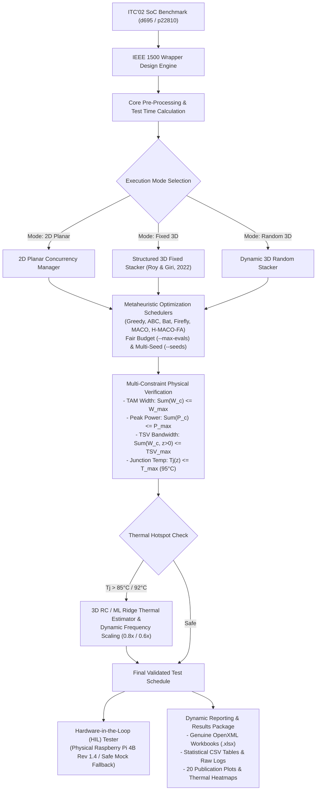

# System Architecture Mermaid Diagram (Verbatim from Root README.md)

## 3. System Architecture & Workflow

The architecture connects core parsing, wrapper optimization, constraint validation, metaheuristic scheduling, thermal lookahead, and reporting:

